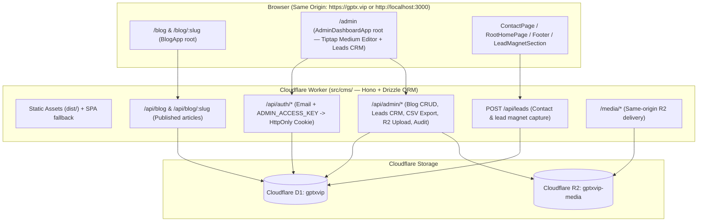

# GPTX.VIP — Cloudflare Worker CMS, Admin Dashboard & GitHub Actions CI/CD Guide

This project uses the same battle-tested **same-origin Cloudflare Worker + D1 + R2 + Workers Static Assets** architecture as `physicsrun-v3`, tailored for GPTX.VIP's multi-root React architecture (`src/main.tsx`).

## Architecture Summary



---

## Step 1: Provision Cloudflare D1 & R2 (One-Time Setup)

Authenticate Wrangler locally:

```bash
cd src/cms
npx wrangler login
npx wrangler whoami
```

Copy the 32-character **Account ID** shown by `wrangler whoami`.

Create the D1 database and R2 media bucket:

```bash
npx wrangler d1 create gptxvip
npx wrangler r2 bucket create gptxvip-media
```

Copy the returned `database_id` UUID into [`src/cms/wrangler.toml`](../src/cms/wrangler.toml):

```toml
[[d1_databases]]
binding = "DB"
database_name = "gptxvip"
database_id = "<PASTE-YOUR-D1-UUID-HERE>"
migrations_dir = "migrations"
```

Apply the initial D1 schema migration locally and remotely:

```bash
npm --prefix src/cms run db:migrate:local
npm --prefix src/cms run db:migrate:remote
```

---

## Step 2: Configure Admin Email & Passkey Secrets

### Local Development (`src/cms/.dev.vars`)

Copy [`src/cms/.dev.vars.example`](../src/cms/.dev.vars.example) to `src/cms/.dev.vars` (gitignored) and set your credentials:

```dotenv
ADMIN_LOGIN_EMAIL="your-email@example.com"
ADMIN_ACCESS_KEY="your-long-random-admin-passkey"
SESSION_SECRET="your-32-plus-char-random-secret"
APP_ORIGIN="http://localhost:3000"
```

Run both frontend and Worker locally on the same origin (`http://localhost:3000`):

```bash
# Terminal 1 — Cloudflare Worker (port 8787)
npm --prefix src/cms run dev

# Terminal 2 — Vite Frontend (port 3000, proxies /api/* & /media/* -> 8787)
npm run dev
```

Visit:
- **Admin Dashboard:** `http://localhost:3000/admin`
- **Public DB Blog:** `http://localhost:3000/blog`
- **Contact Form:** `http://localhost:3000/contact`

### Production Cloudflare Worker Secrets

Set these once via Wrangler CLI (or in Cloudflare Dashboard → Workers → `gptxvip-vps` → Settings → Variables and Secrets):

```bash
cd src/cms
npx wrangler secret put ADMIN_LOGIN_EMAIL
npx wrangler secret put ADMIN_ACCESS_KEY
npx wrangler secret put SESSION_SECRET
# Optional: forward website leads to Web3Forms email inbox in addition to D1
npx wrangler secret put WEB3FORMS_ACCESS_KEY
```

*(Tip: You can also set `ADMIN_BOOTSTRAP_EMAILS` as a comma-separated list if you want multiple admin emails to be allowed.)*

---

## Step 3: Add GitHub Actions Secrets for CI/CD

1. Open **Cloudflare Dashboard → My Profile → API Tokens → Create Token → Create Custom Token**.
2. Grant all **four** Account permissions (missing D1 or R2 causes `[code: 7403]`):
   - **Account → Account Settings → Read**
   - **Account → Workers Scripts → Edit**
   - **Account → D1 → Edit**
   - **Account → Workers R2 Storage → Edit**
3. Open your GitHub repository (`Aliyansayz/gptxvip-vps`) → **Settings → Secrets and variables → Actions** and add:
   - `CLOUDFLARE_API_TOKEN` — your custom Cloudflare API token
   - `CLOUDFLARE_ACCOUNT_ID` — your 32-character Cloudflare Account ID

Every push to `main` or `gptxvip-v2` (or manual **Run workflow** dispatch) runs [`.github/workflows/deploy-gptxvip-cms.yml`](../.github/workflows/deploy-gptxvip-cms.yml):
1. Builds and typechecks the Vite frontend (`dist/`)
2. Typechecks and runs automated tests for `src/cms/`
3. Verifies Cloudflare credentials (`wrangler whoami`)
4. Applies remote D1 migrations automatically whenever `src/cms/migrations/` changes
5. Deploys the `gptxvip-vps` Worker + Static Assets (`wrangler deploy --keep-vars`)
