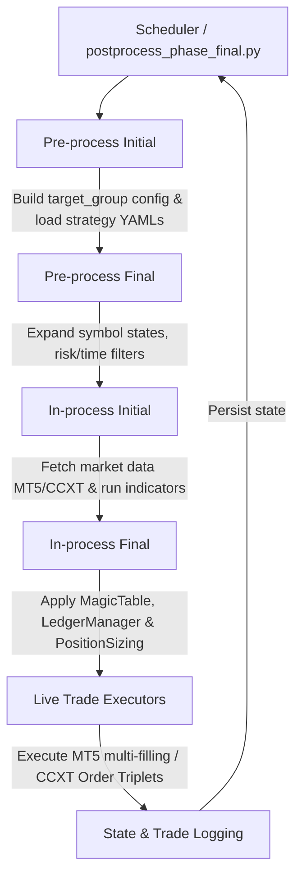

# Feature Fulfillment Analysis: Strategy Workflow Engine

This document provides a detailed analysis of the operational capabilities, target market, and value proposition of the **Strategy Workflow Engine** application.

---

## ┌── Architectural Flow
The system utilizes a structured, multi-phase execution loop designed to isolate data fetching, signal analysis, risk management, and order execution.

---

## 1. What Problem Does This App Solve?

Retail trading is plagued by execution latency, emotional decision-making, fragmented platform interfaces, and capital risk management failures. This application addresses these critical challenges:

*   **Elimination of Emotional Bias & Manual Errors**: Auto-executes trading rules without human hesitation, greed, or fear. Once a strategy (e.g., *Dual Supertrend* or *Linear Regression*) meets its entry or exit parameters, orders are dispatched instantly.
*   **Complex Multi-Timeframe Coordination**: Hand-checking multiple timeframes simultaneously is highly error-prone. The engine resolves this by aligning high-level trends (e.g., secondary M30 timeframe) with execution-level entries and trailing stops (e.g., primary M5 timeframe) in real time.
*   **Unified Cross-Asset Execution**: Traders usually need different applications for Forex and Cryptocurrencies. This system wraps **MetaTrader 5 (MT5)** (for Forex, Gold, Oil) and **CCXT** (for Binance, OKX, and other crypto exchanges) into a single, standardized configuration layout.
*   **Dynamic and Safe Capital Protection**: Naive bots often place orders without proper risk adjustments. This application automatically calculates position sizing (lot sizes) based on current account balance, currency conversions, tick value, and ATR (Average True Range) volatility.
*   **Group State Continuity & Overrides Protection**: 
    > [!IMPORTANT]
    > The codebase includes a custom **Trailing Protection System**. If a strategy fundamentally relies on trailing stops (e.g., `dual_supertrend_trailing`), the system prevents configuration overrides from accidentally turning off trailing exits, preventing catastrophic loss.
*   **Advanced Trade Isolation & Profit Safeguards**:
    *   **Magic Number Ledger (`MagicTable`)**: Solves the issue of multi-strategy order collisions by isolating and tracking individual strategy executions using a persistent JSON-based table (`magic_table_<group_name>.json`).
    *   **Profit Milestone Banking (`LedgerManager`)**: Mitigates risk by tracking consecutive winning streaks. Once a milestone threshold is met, the system "banks" a portion of the gains as a reserved balance (`milestone_info_<group_name>.json`) and subtracts it from subsequent position size calculations, locking in profits.
*   **Time & Session Filtering**: Enforces strict boundaries to avoid trading during high-spread market opens, low-liquidity weekends, or dangerous economic news releases.

---

## 2. Who is the Ideal Customer?

The ideal customer profile spans across systematic retail traders, prop firm participants, and developers:

| Customer Segment | Core Needs | Key Benefits |
| :--- | :--- | :--- |
| **Systematic Retail Traders** | Automated execution of rules-based strategies without staring at charts 24/7. | Full automation of technical indicators (ADX, SMI, Supertrend) with high reliability. |
| **Prop Firm Traders (e.g., FTMO, FundedNext)** | Adherence to rigid daily drawdowns, consistency rules, and risk-per-trade limits. | Hardcoded risk limits (e.g., max 1% per trade), XM Micro-account constraints detection, and milestone banking to preserve profits. |
| **Multi-Asset Portfolio Diversifiers** | Managing exposure across traditional finance (Forex, Metals, Energy) and Crypto in one hub. | Unified YAML configuration that routes orders to MT5 or CCXT exchanges depending on asset class. |
| **Quantitative Developers (Python)** | A clean, modular framework where they can code custom models (Pandas, ML) without writing broker integrations. | Extensible execution pipeline (`Pre-process` $\rightarrow$ `In-process` $\rightarrow$ `Post-process`) where they only write strategy math. |

---

## 3. Why Pay for This Instead of Alternatives?

When compared to commercial trading software, scripting libraries, and custom implementations, this engine offers distinct advantages:

### A. vs. Out-of-the-Box Commercial Bots (e.g., 3Commas, Cryptohopper)
*   **No Platform Lock-in or SaaS Fees**: Commercial SaaS options charge expensive monthly subscriptions and limit features based on pricing tiers. This Python-native system runs locally or on a private VPS for free.
*   **True Forex Support (MT5)**: Most commercial bots are strictly built for Crypto. This application provides robust support for MetaTrader 5, enabling trades on traditional instruments like Forex major/minor pairs, Gold (XAUUSD), and crude oil.
*   **Infinite Technical Customization**: Commercial bots restrict users to basic indicators. This codebase allows arbitrary complex Python logic, such as volatility clustering checks, multi-timeframe smoothing, and custom machine-learning indicators.

### B. vs. TradingView Webhooks
*   **Low Execution Latency**: TradingView alerts rely on third-party webhook relays and web-request hops. This codebase is directly connected to MT5/CCXT APIs, checking ticks and placing orders locally with minimal delay.
*   **State-Aware Logic**: TradingView is "stateless"—it cannot easily check if a broker position was partially closed, stopped out, or needs its trailing stop updated. This engine utilizes a **Group State Management** database to keep continuous track of order tickets and active status.

### C. vs. MQL5 Scripting (MT5 Native)
*   **Power of the Python Data Science Ecosystem**: MQL5 limits developers to C++-like structures. This engine allows developers to leverage `pandas`, `numpy`, `scipy`, and machine learning libraries directly for data manipulation and signals.
*   **Dual-Platform Operations**: MQL5 cannot send order signals to a crypto exchange. This codebase can simultaneously check indices in MT5 and hedge or trade correlation pairs in Binance via CCXT.

### D. vs. Naive Custom Python Scripts
*   **Execution Robustness**:
    *   *MetaTrader 5*: Employs a multi-filling mode attempt cycle (`ORDER_FILLING_IOC`, `ORDER_FILLING_FOK`, `ORDER_FILLING_RETURN`) to guarantee order execution under varying broker configurations. It also verifies symbol compatibility and adjusts partial-close lot sizes according to broker minimum quantity/step requirements (`ispartialtradeeligible`).
    *   *CCXT / Binance Futures*: Performs dynamic margin-leverage regulation (`_resolve_leverage`), fetches brackets (`fapiPrivateGetLeverageBracket`), and submits entry-SL-TP order triplets utilizing `'reduceOnly': True` to eliminate the risk of accidental opposite-side exposure.
*   **Fail-Safe Architecture**: Writing a custom script from scratch is risky. This system provides a field-tested workflow separation:
    1.  **Pre-process**: Validates parameters and overrides.
    2.  **In-process**: Separates read operations (data fetching and indicators) from write operations (execution).
    3.  **Post-process**: Controls scheduling and loops safely.
*   **Configurability**: Changing strategy behavior doesn't require modifying Python code. It is done entirely through readable YAML files (`live_strategy_config.yaml`).
